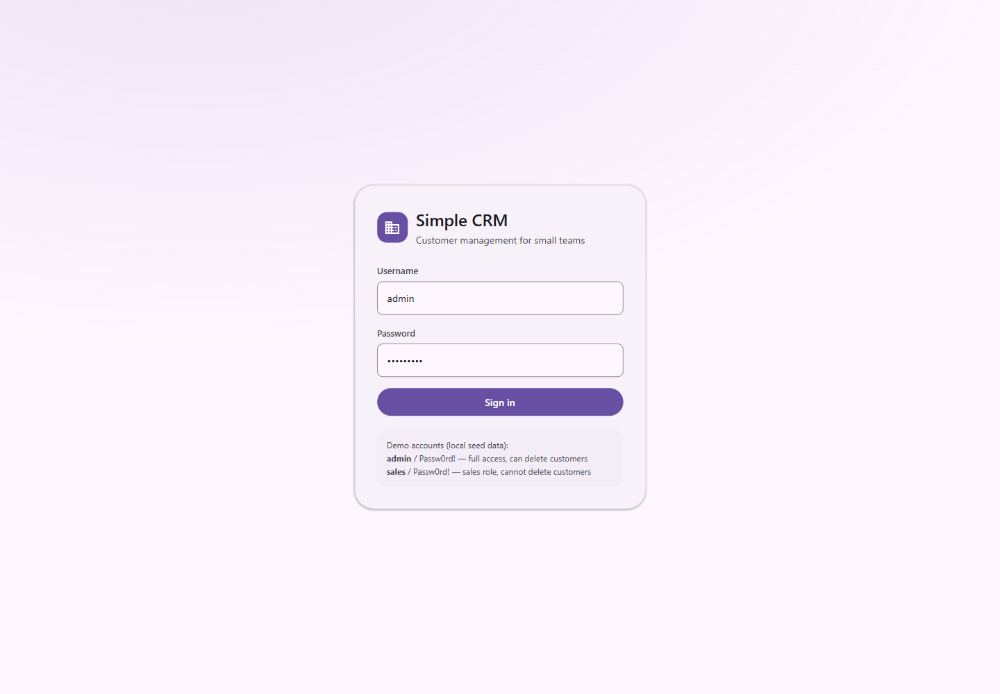
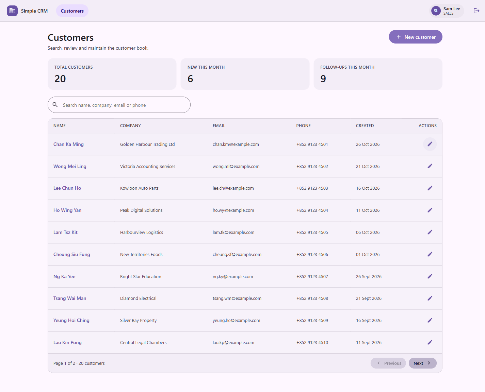
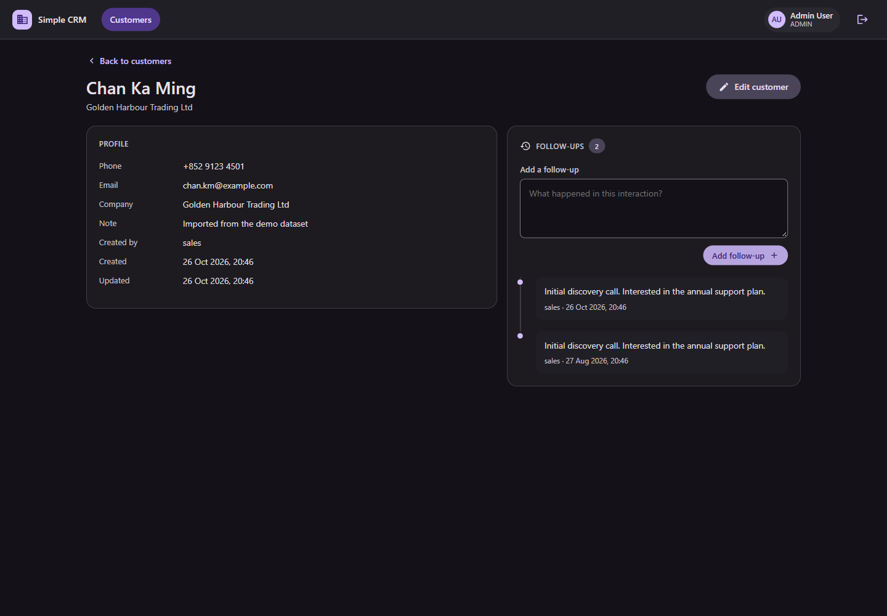
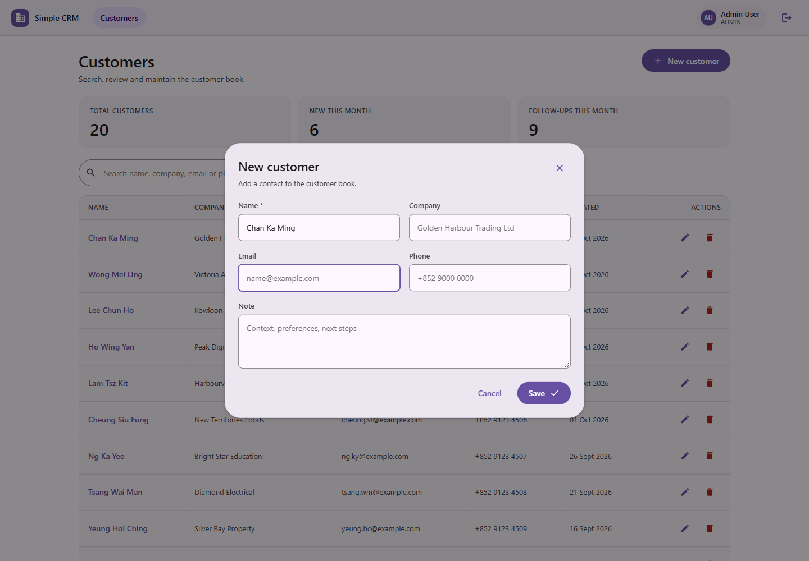
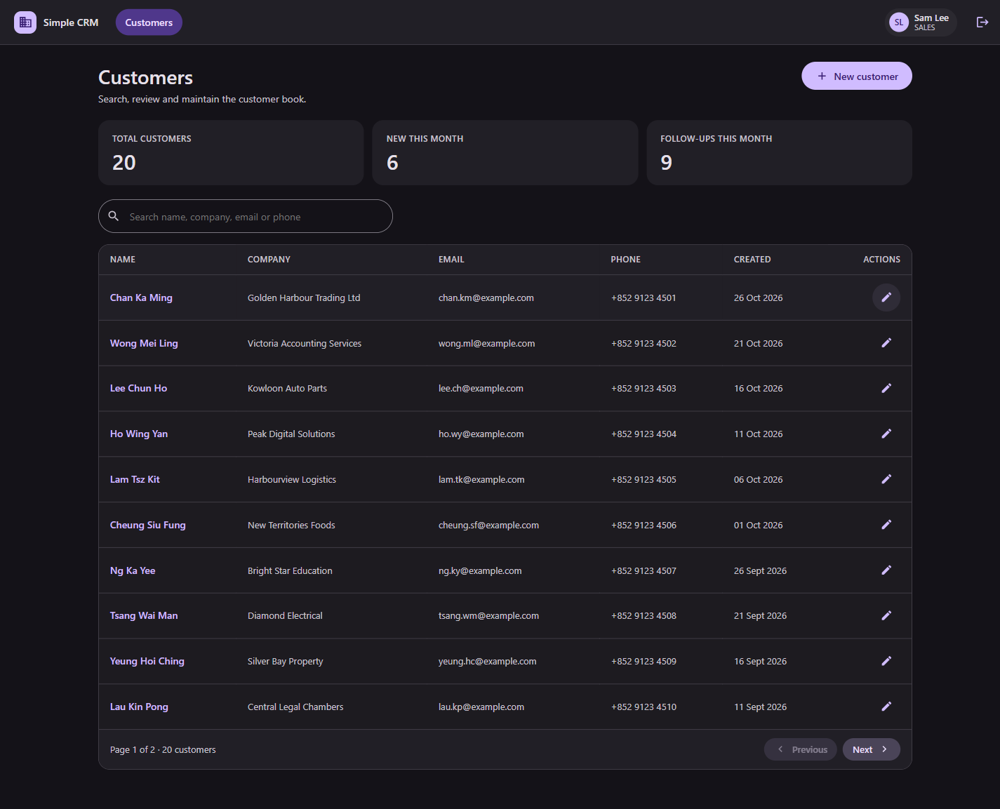
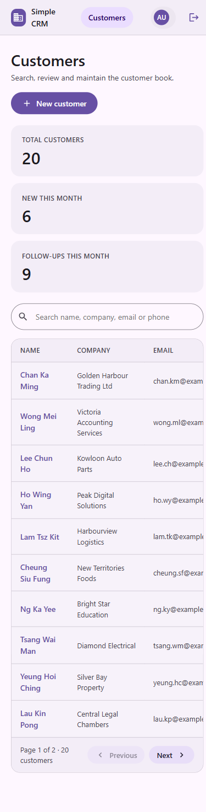
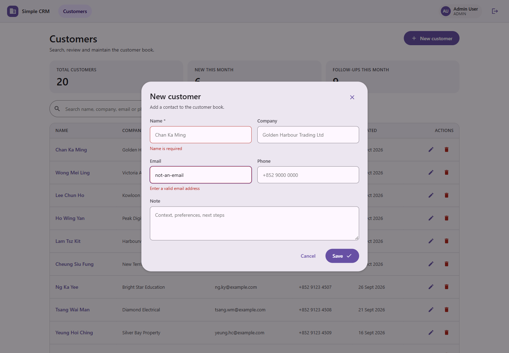

<p align="center"></p>

# Simple CRM

[](https://github.com/ChanKinChing/App-Simple-CRM/actions/workflows/ci.yml)

中小企業客戶管理系統，作為 Java／Spring Boot 求職作品集。提供 JWT 登入、角色權限（ADMIN／SALES）、客戶資料 CRUD、關鍵字搜尋與分頁、跟進記錄時間軸、首頁統計，以及 Material Design 3 風格的前端（明暗主題自動跟隨系統）。

- 後端：Spring Boot 3.5.16 / Java 17 / Maven Wrapper
- 資料庫：PostgreSQL 17 + Flyway migration
- 前端：React 19 + Vite（原生 CSS，M3 design token）
- 認證：Spring Security + JWT（OAuth2 Resource Server，HS256）

## 功能

| 功能 | 說明 |
| --- | --- |
| 登入／登出 | `POST /api/auth/login` 換發 JWT，前端存 localStorage，逾時自動回登入頁 |
| 角色權限 | `ADMIN` 可刪除客戶；`SALES` 只能新增／修改；後端以 `@PreAuthorize` 強制，前端同步隱藏按鈕 |
| 客戶列表 | 關鍵字搜尋（姓名／公司／Email／電話）、分頁、排序（欄位白名單） |
| 客戶詳情 | 完整資料 + 跟進記錄時間軸，可即時新增跟進 |
| 表單驗證 | 前端即時檢查；後端 400 的 `fieldErrors` 會對應到各欄位顯示 |
| 統計摘要 | 客戶總數、本月新客、本月跟進次數 |
| 主題 | Material Design 3 token，`prefers-color-scheme` 自動切換明暗 |
| 種子資料 | 首次啟動寫入 2 個帳號、20 間香港公司、30 筆跟進記錄 |

## 技術棧

| 層 | 選用 | 備註 |
| --- | --- | --- |
| 語言 | Java 17（Temurin） | Boot 3.5 的最低要求 |
| 框架 | Spring Boot 3.5.16 | Web / Data JPA / Validation / Security / Actuator |
| 認證 | `spring-boot-starter-oauth2-resource-server` + Nimbus | 自行簽發 HS256 token，不手寫 filter |
| 資料庫 | PostgreSQL 17.11（可攜版） | 免安裝服務，`Tool-PostgreSQL-17-Portable-1.0.0` |
| Migration | Flyway | `V1__init.sql` 為唯一真實來源，Hibernate `ddl-auto: validate` |
| 文件 | springdoc-openapi | `/swagger-ui.html`、`/v3/api-docs` |
| 前端 | React 19 + Vite 8 + React Router 7 + axios | 無 UI library、無 Tailwind，純 CSS token |
| 測試 | JUnit 5 + MockMvc + 真實 PostgreSQL | 32 個測試，含 CORS 與權限迴歸 |

## 畫面

| 登入 | 客戶列表（明） |
| --- | --- |
|  |  |

| 客戶詳情（暗） | 新增客戶 |
| --- | --- |
|  |  |

| 列表（暗） | 手機版（390px） |
| --- | --- |
|  |  |

表單驗證（前端即時檢查，後端錯誤同樣映射到欄位）：



## 系統架構

```
Browser (React 19 + Vite)
   │  axios，Bearer <JWT>
   ▼
Spring Security filter chain ── JWT 解碼（HS256）── 角色 → ROLE_ADMIN / ROLE_SALES
   ▼
Controller ─ Service ─ Repository (Spring Data JPA) ─ PostgreSQL 17
   │
   └─ 全域例外處理：401 / 403 / 404 / 400（含 fieldErrors）
```

```
App-Simple-CRM-1.0.0/
├── backend/
│   ├── src/main/java/com/b0ss/crm/
│   │   ├── auth/        JwtService、AuthService、AuthController
│   │   ├── config/      SecurityConfig、JwtConfig、OpenApiConfig
│   │   ├── customer/    Entity、Repository、Service、Controller、DTO
│   │   ├── followup/    跟進記錄（隸屬客戶）
│   │   ├── report/      統計摘要
│   │   ├── user/        AppUser、Role、UserDetailsService
│   │   ├── demo/        DemoDataSeeder（可用 APP_SEED_DEMO=false 關閉）
│   │   └── common/      PageResponse、全域例外處理
│   └── src/main/resources/db/migration/V1__init.sql
├── frontend/
│   └── src/
│       ├── api/client.js       axios 實例 + 401 攔截
│       ├── auth/AuthContext.jsx
│       ├── components/         Icon、Modal、Pagination、CustomerForm
│       ├── layout/AppShell.jsx
│       ├── pages/              Login、Customers、CustomerDetail
│       └── styles.css          M3 tokens（light/dark）
├── docs/  openapi.yaml、CONVENTIONS.md、logo.svg、screenshots/
├── PLAN.md  開發計劃與決策記錄
└── README.md
```

## 快速開始

前置需求：JDK 17、Node.js 20+、PostgreSQL 17（本機使用可攜版）。

```bat
:: 1. 啟動本機 PostgreSQL 17（任何安裝方式皆可，預設監聽 127.0.0.1:5432）
::    若使用可攜版：set PG_HOME=<資料夾> 後執行 %PG_HOME%\start-pg.bat
pg_ctl -D <你的資料目錄> start

:: 2. 後端（http://127.0.0.1:8080）
cd backend
mvnw spring-boot:run

:: 3. 前端（http://127.0.0.1:5173）
cd frontend
npm install
npm run dev
```

開啟 `http://127.0.0.1:5173`，使用種子帳號登入：

| 帳號 | 密碼 | 角色 | 權限 |
| --- | --- | --- | --- |
| `admin` | `Passw0rd!` | ADMIN | 全部，含刪除客戶 |
| `sales` | `Passw0rd!` | SALES | 新增／修改，不能刪除 |

Swagger UI：`http://127.0.0.1:8080/swagger-ui.html`

### 一鍵啟停與冒煙測試（Windows PowerShell）

```powershell
scripts\dev-start.ps1     # 需要時才啟動 PostgreSQL / 後端 jar / Vite，並等待健康檢查
scripts\dev-stop.ps1      # 停止前端與後端（加 -IncludeDatabase 連 PostgreSQL 一起停）
scripts\smoke.ps1         # 12 項端到端檢查：健康、登入、401、分頁、搜尋、新增、驗證、跟進、報表、刪除
```

`dev-start` 會顯示各階段的等待秒數，`smoke.ps1` 逐項輸出 PASS/FAIL 與耗時，全部通過才回傳 exit code 0。

腳本不寫死任何本機路徑：JDK 依序從 `JAVA_HOME`（process → 使用者 → 系統）與 `C:\Program Files\Eclipse Adoptium` 自動偵測 17+；PostgreSQL 需先自行啟動，或設定 `PG_HOME` 指向含 `start-pg.bat` 的可攜版資料夾。

### 環境變數

| 變數 | 預設 | 用途 |
| --- | --- | --- |
| `SPRING_DATASOURCE_URL` | `jdbc:postgresql://127.0.0.1:5432/simplecrm` | JDBC |
| `SPRING_DATASOURCE_USERNAME` / `PASSWORD` | `crm_app` / `crm_dev_local` | 應用帳號（非 superuser） |
| `JWT_SECRET` | 開發用字串 | 生產必須覆寫（≥ 32 bytes） |
| `JWT_TTL_MINUTES` | `60` | token 有效期 |
| `APP_SEED_DEMO` | `true` | 首次啟動是否寫入示範資料 |
| `APP_CORS_ALLOWED_ORIGINS` | `http://localhost:5173,http://127.0.0.1:5173` | 逗號分隔的允許來源 |

前端不需要環境變數：dev 由 Vite proxy 把 `/api` 轉到 8080，容器內由 nginx 反向代理，兩者都是同源請求。

### Docker Compose（已實機驗證）

```bat
copy .env.example .env
docker compose up -d --build
```

前端 http://localhost:8082（nginx）、後端 http://localhost:8080、資料存於 named volume `crm-db-data`。實測（Docker 29.9.2）：建置 91 秒、整棧啟動到 `health=UP` 42 秒，`db/backend/frontend` 三個容器皆 healthy；前端 SPA fallback、`/api` 反向代理、401、分頁、報表、非 root 使用者（`uid=100(app)`）全部通過。詳細步驟、Jenkins（8081）設定與驗證清單見 `docs/DEPLOYMENT.md`。

## API

| Method | Path | 權限 | 說明 |
| --- | --- | --- | --- |
| POST | `/api/auth/login` | 公開 | 帳密換 JWT |
| GET | `/api/auth/me` | 已登入 | 目前使用者 |
| GET | `/api/customers` | 已登入 | `q`、`page`、`size`、`sort=field,dir` |
| GET | `/api/customers/{id}` | 已登入 | 單筆 |
| POST | `/api/customers` | 已登入 | 新增 |
| PUT | `/api/customers/{id}` | 已登入 | 更新 |
| DELETE | `/api/customers/{id}` | ADMIN | 刪除（連同跟進記錄） |
| GET | `/api/customers/{id}/follow-ups` | 已登入 | 分頁列出跟進 |
| POST | `/api/customers/{id}/follow-ups` | 已登入 | 新增跟進 |
| GET | `/api/reports/summary` | 已登入 | 統計摘要 |

完整契約見 `docs/openapi.yaml`。

## 測試

```bat
cd backend
mvnw verify
```

32 個測試（18 個 Mockito 單元測試 + 14 個 Spring 整合測試，後者打真實 PostgreSQL `simplecrm_test`，不使用 H2）：

- `CustomerServiceTest`（8）、`AuthServiceTest`（4）、`FollowUpServiceTest`（4）、`ReportServiceTest`（2）：Mockito 單元測試
- `CustomerApiIntegrationTest`（10）：401／403／400／404、分頁總數、CRUD 全流程
- `CorsConfigurationTest`（3）：允許的來源（localhost 與 127.0.0.1）可通過，未知來源回 403
- `SimpleCrmApplicationTests`（1）：context 載入

前端：

```bat
cd frontend
npm run lint
npm run build
```

### CI

`.github/workflows/ci.yml`：GitHub Actions 兩個 job。

- **backend**：起一個 `postgres:17-alpine` service，跑 `mvnw verify`，上傳 surefire 報告
- **frontend**：`npm ci` → `npm run lint` → `npm run build`，上傳 `dist`

測試所需的 DB 連線可透過 `TEST_DATABASE_URL` / `TEST_DATABASE_USERNAME` / `TEST_DATABASE_PASSWORD` 覆寫，因此本機與 CI 共用同一份 `application-test.yml`。

## 設計決策

- **用 OAuth2 Resource Server 而非自寫 filter**：Spring 官方路線，JWT 解析、時鐘偏移、簽章驗證都交給框架，減少安全漏洞面。
- **排序白名單**：`sort` 只接受 `name, company, email, createdAt, updatedAt`；不合法時整組退回 `createdAt,desc`（連方向一起忽略），避免 JPA 任意 property 造成 500 或探測 schema。
- **Flyway 為 schema 唯一來源**：`ddl-auto: validate`，啟動時若 entity 與 DB 不一致會直接失敗，避免「本機能跑、上線炸」。
- **不用 H2／Testcontainers**：測試直接打本機 PostgreSQL，換來與正式環境一致的 SQL 行為；代價是 CI 需要一個 DB service。
- **前端不用 UI library**：以 Material 3 token 手寫 CSS，`light-dark()` 變數 + `prefers-color-scheme`；表單錯誤同時吃前端驗證與後端 `fieldErrors`。
- **CORS 明確列出兩個 dev 來源**：`localhost` 與 `127.0.0.1` 是不同 origin，Spring 對未允許的來源直接回 403（不是 CORS header 缺失），曾讓登入表單看似「帳密錯誤」。此坑已寫成迴歸測試。

## 已知限制

- Spring Boot 3.5.x 的 OSS 支援已於 2026 年中結束，本專案為學習用途。
- token 存放於 localStorage（XSS 風險）；生產應改用 HttpOnly cookie + CSRF 保護或短效 token + refresh。
- 尚無 refresh token、登出黑名單、登入嘗試次數限制。
- 客戶無 soft delete、無審計欄位歷史；刪除為硬刪除（連同跟進記錄）。
- 多使用者同時編輯同一客戶時後寫入者覆蓋（未做樂觀鎖）。
- Docker Compose 與 Jenkinsfile 已寫好但**尚未實機驗證**（本機未安裝 Docker Desktop），步驟見 `docs/DEPLOYMENT.md`。

## Roadmap

- [x] 階段 0 環境與骨架
- [x] 階段 2 API 契約、schema、命名規範
- [x] 階段 3–4 後端 CRUD、JWT、RBAC
- [x] 階段 5 服務層與 API 整合測試
- [x] 階段 6 React 前端（登入／列表／詳情／表單／明暗主題）
- [x] 階段 7 GitHub Actions（後端測試 + 前端 lint/build）
- [ ] 階段 7b Jenkins（Docker 8081，Jenkinsfile 已備，待 Docker 驗證）
- [x] 階段 8 Dockerfile、compose、部署文件、Swagger UI（容器待實測）
- [ ] 階段 9 逐檔導讀與 demo 錄影
